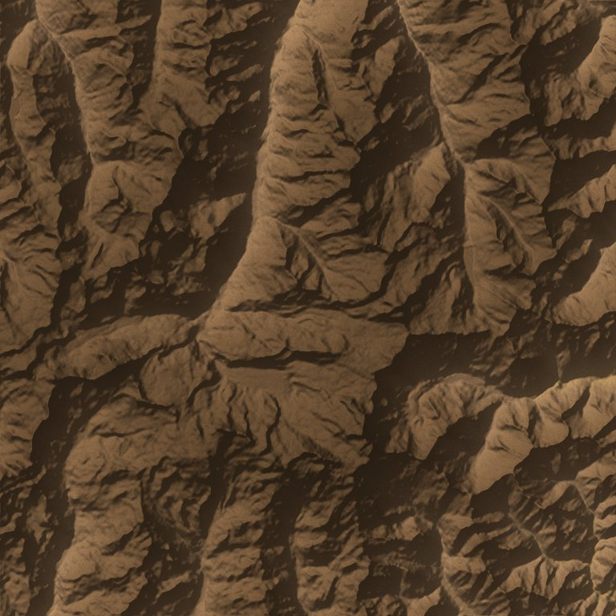
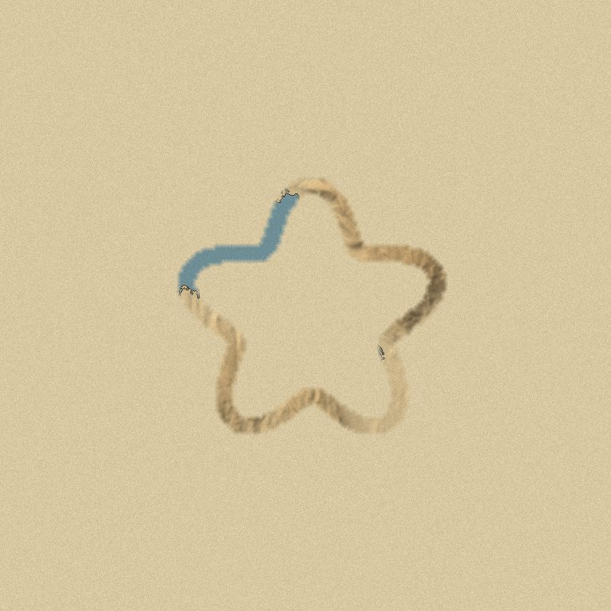
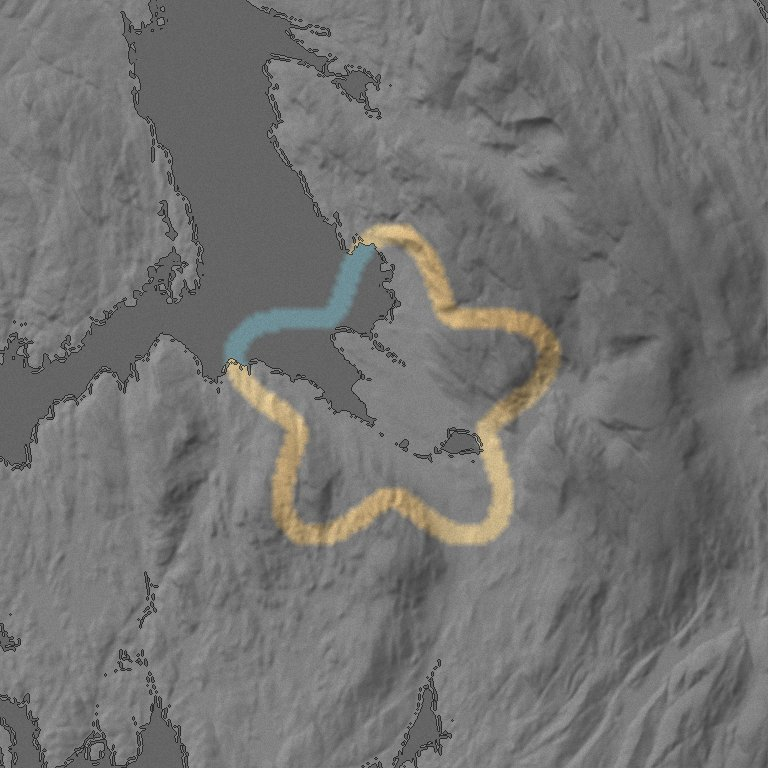
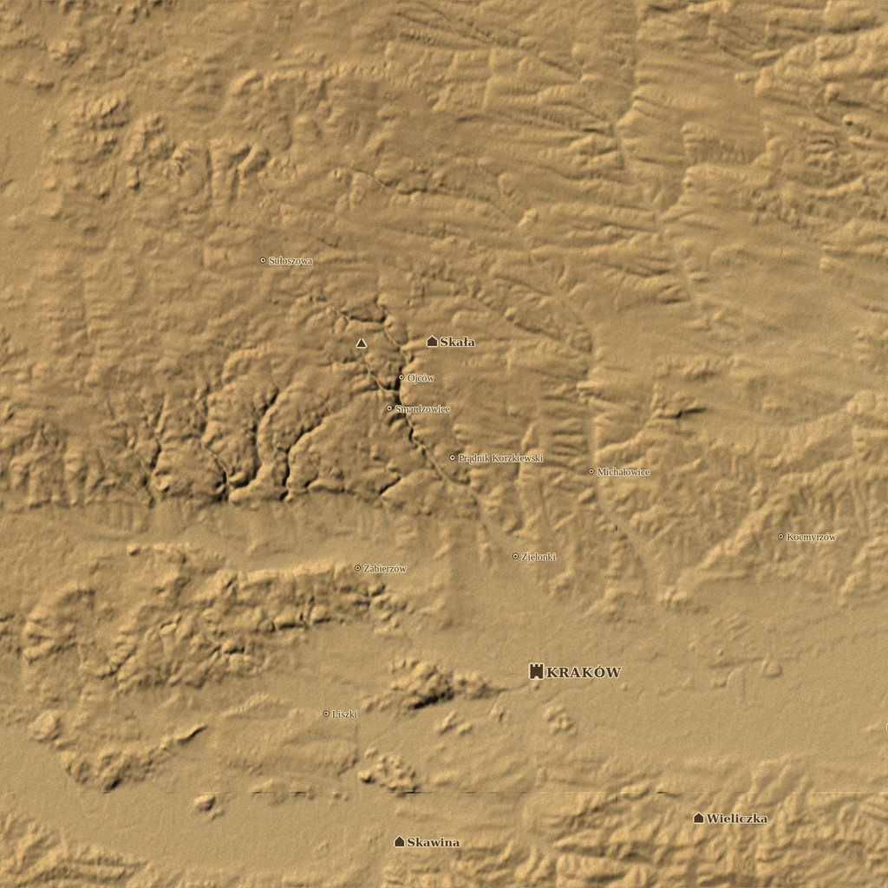
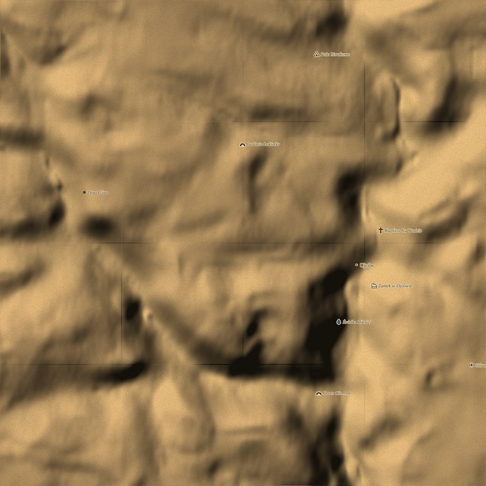
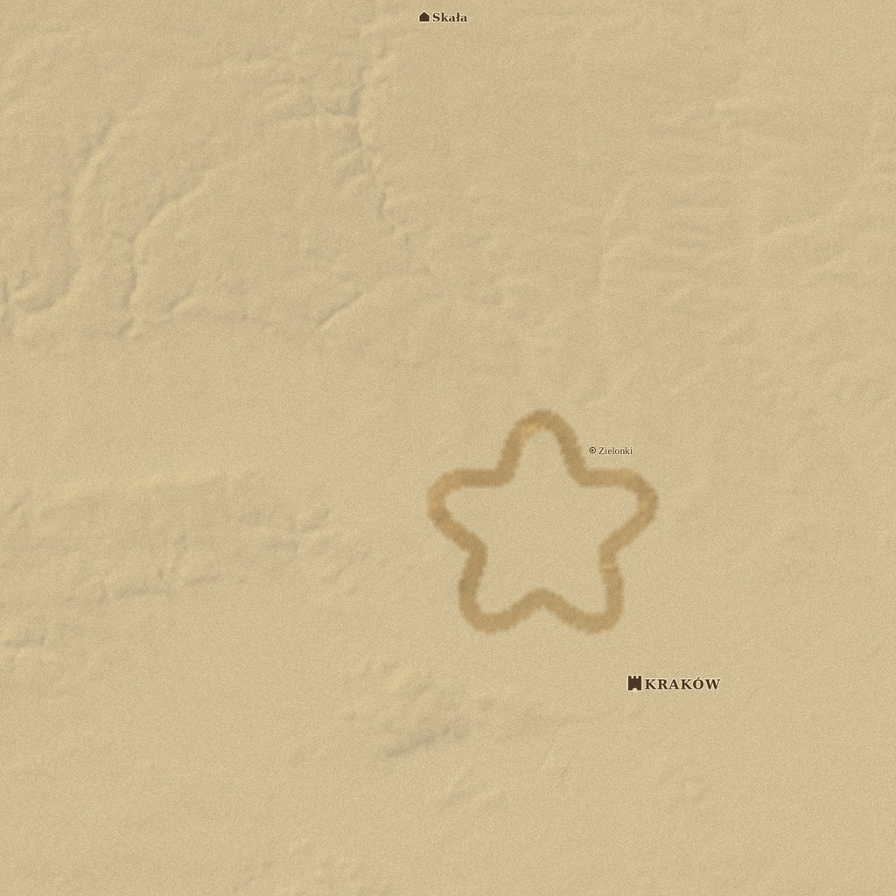
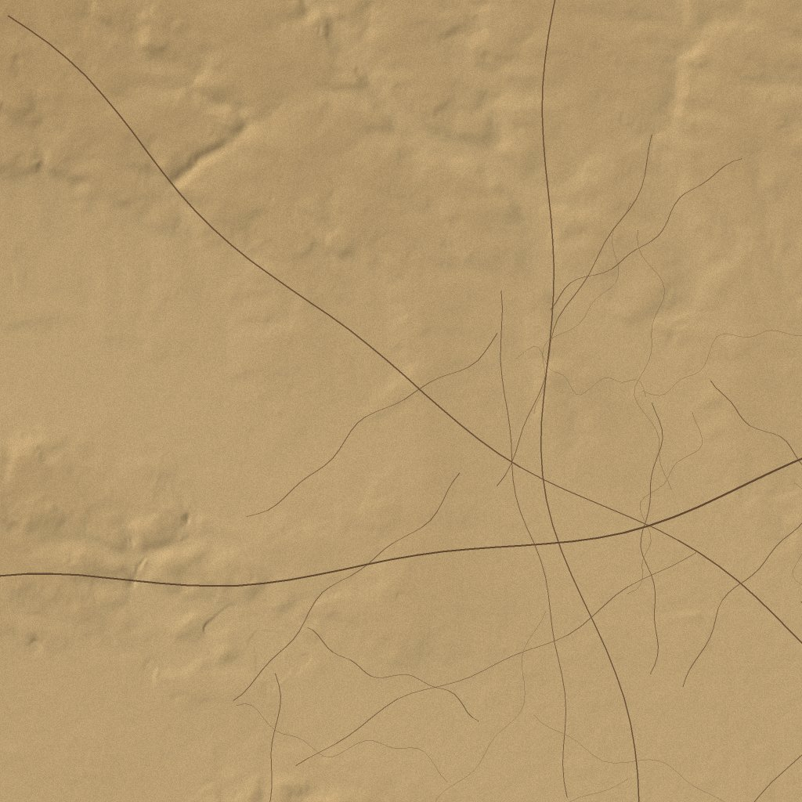
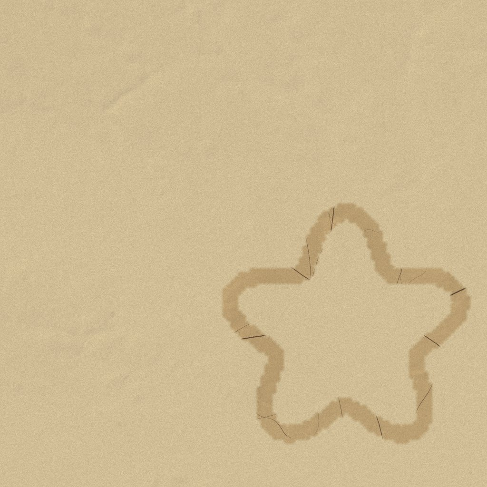

# Morrowind-like map

A real-world map drawn like the in-game map from *The Elder Scrolls III: Morrowind*: parchment-brown
relief from a heightmap and muted blue water. Roads and paths are inked in only where you have been,
so the map fills in as you explore. Towns and villages are inked on in the style of the game maps, and zooming in reveals waypoints such as peaks, castles, huts and caves. On top
sits a **fog of war**:
the map stays hidden until you have been there. Places are revealed from GPS routes your watch
**already records** during runs, hikes and rides. The app never turns on GPS itself.

| Terrain (z11, Alps) | Fog: hidden | Fog: grayed |
|---|---|---|
|  |  |  |

| Towns (z11, Kraków) | Waypoints (z15, Ojców valley) | Places + fog: towns always, villages once visited |
|---|---|---|
|  |  |  |

*(Previews from `tools/preview.py`, with water from elevation only, a synthetic route and hand-picked
demo places from `tools/demo-places.json`. The apps read real places from OpenStreetMap.)*

## Roads

Roads, tracks and footpaths from OpenStreetMap are drawn as ink lines, but **only in the explored
area**. They stay hidden under the fog even where the fog lets the terrain show through, and fade out
with its soft edge. Major roads show from z6–9, minor roads and tracks from z12, paths from z13.

| Road layer (synthetic demo network, z13) | The same, only where explored |
|---|---|
|  |  |

## Places and waypoints

- **Cities and towns** are always on the map, like the major cities on the *Oblivion* map.
- **Villages, hamlets, peaks** and **waypoints** (castles, ruins, huts, campsites, viewpoints, caves,
  chapels, monuments, springs, lighthouses) appear once one of your routes has passed near them.
  A setting can show everything instead (undiscovered places faded) or turn places off.
- Detail grows with zoom: cities from z4, towns from z8, villages and peaks from z11, waypoints from
  z13–15. Labels never overlap; less important ones give way.
- The data comes from the same OpenFreeMap vector tiles as the water, so it needs no extra downloads.

Spec: [shared/waypoints-spec.md](shared/waypoints-spec.md).

## Repository layout

| Folder | What |
|---|---|
| [`apple/`](apple/) | iOS + watchOS apps and the shared Swift package. **First target.** |
| [`garmin/`](garmin/) | Garmin Connect IQ (planned) |
| [`android/`](android/) | Android + Wear OS (planned) |
| [`shared/`](shared/) | Specs every platform follows: [palette](shared/palette.json), [rendering](shared/render-spec.md), [waypoints](shared/waypoints-spec.md), [fog format](shared/fog-format.md), [data sources](shared/data-sources.md) |
| [`tools/`](tools/) | `preview.py`, the reference renderer for tuning the look on a desktop; `sync-palette.sh` |

## Map data (free, no API keys)

- **Elevation**: AWS Terrain Tiles (Terrarium PNG, z0–15)
- **Water, roads, places and POIs**: OpenFreeMap vector tiles (OpenStreetMap data, OpenMapTiles schema, z0–14)

Tiles are rendered on the device into the Morrowind style and cached permanently. Details and
attribution are in [shared/data-sources.md](shared/data-sources.md).

## Quick start

- Apple: see [apple/README.md](apple/README.md). Run `cd apple && swift test`, then `xcodegen`, then open in Xcode.
- Tune the look without Xcode:

  ```bash
  pip install numpy pillow
  ```

  ```bash
  python3 tools/preview.py --lat 46.0 --lon 7.75 --zoom 11 --fog-demo -o preview.png
  ```

  Add `--places-demo` to draw the demo places, for example:

  ```bash
  python3 tools/preview.py --lat 50.07 --lon 19.98 --zoom 11 --size 4 --places-demo -o places.png
  ```

  After editing `shared/palette.json`, run `tools/sync-palette.sh`.
